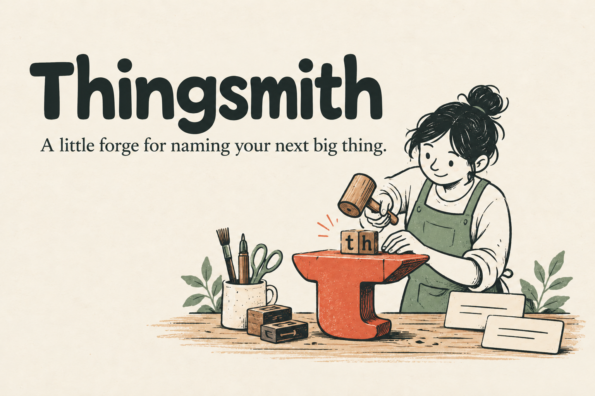
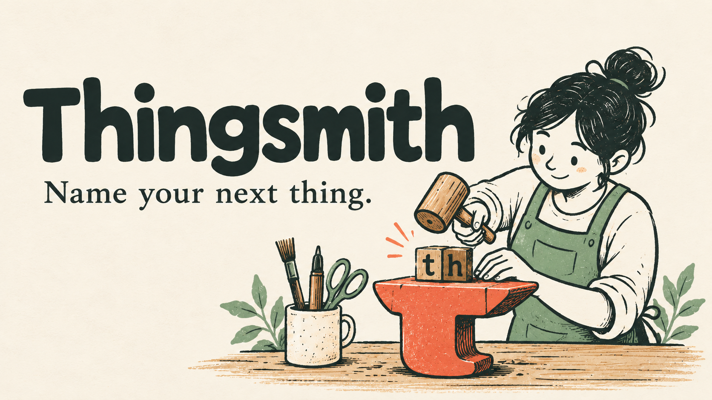

# Thingsmith media kit

**Thingsmith: a little forge for naming your next big thing.**

Use the [style and palette](../assets/STYLE.md) for future illustrations. The assets below are included in this repository's MIT licence. References linked in the source guide remain their owners' work; no third-party guide or logo is included.

## README scenes

## /tech thumbnails

Primary launch post: use the forge thumbnail. For an evidence-focused technical angle, use the availability thumbnail. Both are wide compositions with large type; preserve the whole composition when placing them in a blog card. No live blog site was changed.

Suggested alt text is provided in the embeds. The scene illustrations convey concepts, not actual check results. Keep the explanation in article text too.
